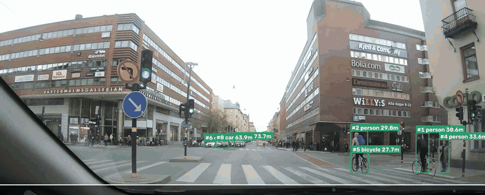

# Urban 3D Perception

**Monocular metric 3D perception and collision-risk assessment from a single dashcam.**

[Live demo](https://AribQureshi.github.io/urban-3d-perception/) · [Technical report](REPORT.md) · 



From one uncalibrated camera, the system detects and tracks every road user, measures distance in metres with a Vision Transformer, and lifts objects into 3D. Each trajectory is smoothed with a depth-aware Kalman filter, then scored for time-to-collision risk, and unusual behaviour is flagged without labels. Results are explored in an interactive web dashboard.

## Highlights
- **Metric 3D from one camera:** Depth Anything V2 (ViT) + pinhole back-projection, with robust median-of-box depth.
- **Depth-aware Kalman filter:** measurement noise grows with distance, cutting distance jitter by **45%** and speed noise by **90%** compared with raw depth (see [report](REPORT.md#4-results)).
- **Ground-truth-free scale check:** a RANSAC road-plane fit on the reconstructed point cloud recovers camera height (**2.36 m** on the sample clip, flagging that monocular depth overestimates distance there by about 1.8×).
- **Risk and anomalies:** time-to-collision risk levels and Isolation Forest anomaly detection over track behaviour.
- **Ego-vehicle mask:** ignores the car's own dashboard, bonnet and driver, so cameras mounted inside the cabin don't raise false alarms (`configs/cockpit.yaml`).
- **Interactive dashboard:** synced video overlays, bird's-eye view, distance timeline, Three.js point cloud, track explorer and evaluation. Static site, hosted on GitHub Pages.
- **Engineering:** typed YAML config, per-stage latency profiling, 20 unit tests, GitHub Actions CI.

## Architecture

```
frame ─► YOLOv8 ─► ByteTrack ─────────┐
  │                                   ├─► median box depth ─► pinhole 3D ─► Kalman (X, Z, Vx, Vz) ─► TTC risk
  └────► Depth Anything V2 (ViT) ─────┘                                                              │
              │                                                                     Isolation Forest anomalies
              └─► point cloud ─► RANSAC ground plane ─► camera-height check
                                                                    ▼
                    outputs/ (CSV, PLY, annotated video)  +  docs/data/ (web dashboard bundle)
```

## Repository layout

```
u3p/
  config.py       typed config (YAML)
  models.py       YOLOv8 + ByteTrack, Depth Anything V2
  geometry.py     camera model, 3D lifting, point cloud, RANSAC, PLY export
  tracking3d.py   depth-aware constant-velocity Kalman filter, jitter metric
  risk.py         time-to-collision risk, Isolation Forest
  pipeline.py     end-to-end run, profiling, ablation, exports
  viz.py          annotated video rendering
scripts/run.py    command-line entry point
configs/          default.yaml
tests/            unit tests (geometry, Kalman, risk, anomaly)
docs/             web dashboard (GitHub Pages); docs/data is produced by the pipeline
notebooks/        Colab notebook: run everything on a free GPU
REPORT.md         technical report
```

## Quick start

**Colab (free GPU):** open `notebooks/Urban_3D_Perception.ipynb`, set the runtime to T4 GPU, and click Run all.

**Local:**
```bash
pip install -r requirements.txt
python scripts/run.py --video samples/drive.mp4           # writes outputs/ and docs/data/
python -m http.server -d docs 8000                        # open http://localhost:8000
pytest -q tests
```
Options: `--max-frames`, `--stride`, `--hfov` (camera field of view), `--config`.

## Results

11.3 s 4K urban clip filmed from inside the car (169 frames processed, `configs/cockpit.yaml`), Apple M5 laptop, **4.5 FPS** end to end.

| Distance estimate | Jitter (m) | Speed noise (m/s) |
|---|---:|---:|
| Raw per-frame depth | 3.782 | 45.21 |
| Kalman filtered | 2.072 | 4.69 |
| **Reduction** | **45.2%** | **89.6%** |

28 tracked road users. The ego mask removed 129 false detections of the driver and dashboard. The RANSAC road plane gives a camera height of 2.36 m against an expected 1.2 to 1.4 m, so absolute distances on this clip are overestimated. Details in the [report](REPORT.md#4-results).

## Limitations
The field of view is assumed rather than calibrated, monocular depth degrades past about 40 m, velocities on newly seen distant objects are noisy enough to trigger occasional false alarms, and evaluation uses ground-truth-free proxies. See [REPORT.md](REPORT.md#5-discussion-and-limitations) for the KITTI evaluation plan.
